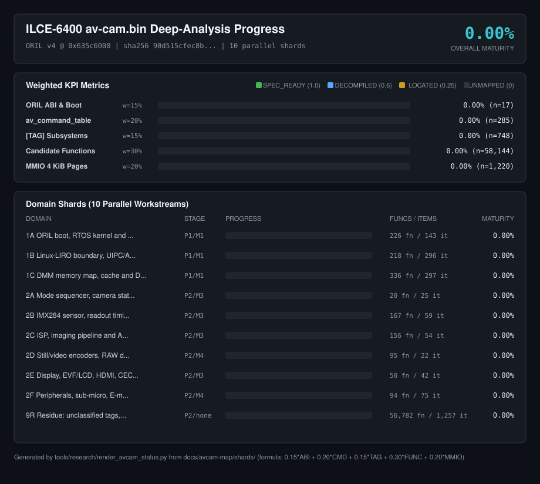

# `av-cam.bin` research map (Phase 0 output)



This page is the **map of the deep research still required per area** of the
ILCE-6400 `av-cam.bin`, produced by the Phase 0 infrastructure of the av-cam
research plan. It recognises areas and hands each one a shard, a set of measured
entry points and the questions that must be answered. It does **not** contain
the answers: no area below has been researched, decompiled or reimplemented
here.

| Item | Value |
| --- | --- |
| Input | `artifacts/qemu-a6400/capture-20261117/run/av-cam.bin` |
| SHA-256 | `90d515cfec8b936f1ba9a69dcac462816b880297752a652474d67c4bba39125e` |
| Size / format | 16,674,456 B, flat `ORIL` v4 (not ELF) |
| Mapping | VA `0x635c6000..0x645ace98` (PA `0x035c6000..0x045ace98`) |
| Evidence | [E0759](evidence/0759-avcam-phase0-index-shards-and-research-map.md) |
| Generated data | `artifacts/analysis/avcam-map/` (index report, SQLite map, shards, dashboard) |

## 1. Reproduce the skeleton

```powershell
# one command: scan -> SQLite map -> shards -> progress dashboard (about 60 s)
.\venv\Scripts\python.exe -m tools.research.avcam_indexer build `
    artifacts\qemu-a6400\capture-20261117\run\av-cam.bin `
    --out artifacts\analysis\avcam-map

# Ghidra raw import at the ORIL base (needs WSL + Ghidra headless)
.\venv\Scripts\python.exe -m tools.research.avcam_ghidra stage --out artifacts\analysis\avcam-map
.\venv\Scripts\python.exe -m tools.research.avcam_ghidra import `
    --image artifacts\qemu-a6400\capture-20261117\run\av-cam.bin --out artifacts\analysis\avcam-map
.\venv\Scripts\python.exe -m tools.research.avcam_ghidra verify --out artifacts\analysis\avcam-map

# read-only checks
.\venv\Scripts\python.exe -m tools.research.avcam_dashboard --check --out artifacts\analysis\avcam-map
.\venv\Scripts\python.exe -m unittest tests.test_avcam_image tests.test_avcam_dashboard `
    tests.test_avcam_xrefs tests.test_avcam_ghidra -q
```

Outputs, all under `artifacts/analysis/avcam-map/` (git-ignored, regenerated):

| File | Content |
| --- | --- |
| `avcam_map.sqlite` | regions, candidate functions, call edges, literals, strings, tags, MMIO refs, 285 commands |
| `avcam_index_report.md` / `.json` | measured profile of this image and the scan's limits |
| `shards/S*.json` | one editable file per domain: items at `UNMAPPED` plus the signal that put them there |
| `avcam_progress.md` / `.json` | the five KPI metrics, per-domain scope, overall maturity |
| `ghidra/import_receipt.json` | PASS/FAIL receipt for the raw `ARM:LE:32:v7` import at `0x635c6000` |
| `ghidra/bounded_result.json` | `BoundedThumbProcedures` output on the imported raw program |

## 2. Measured image profile

The layout below is measured from the bytes (64 KiB block classification), not
copied from the first reconnaissance. Where the two disagree the measured value
is used and the difference is recorded in §2.2.

### 2.1 Regions

| Kind | VA range | Size | Content |
| --- | --- | ---: | --- |
| code | `0x635c6000..0x63dd6000` | 8,454,144 B | Thumb-2 body; ARM stub only at `0x635c6030..0x635c6044` |
| data | `0x63dd6000..0x63e86000` | 720,896 B | pointer tables and the first log strings |
| rodata | `0x63e86000..0x63f26000` | 655,360 B | printable strings (≥ 85 % of the block) |
| data | `0x63f26000..0x63f46000` | 131,072 B | mixed tables |
| rodata | `0x63f46000..0x63f86000` | 262,144 B | printable strings |
| data | `0x63f86000..0x64046000` | 786,432 B | tables and pooled constants |
| bss | `0x64046000..0x644c6000` | 4,718,592 B | 100 % zero, 4.5 MiB |
| data | `0x644c6000..0x645ace98` | 945,816 B | initialised RW data, including the `LIRO` copy and `av_command_table` |

Header: nine vector words at `0x635c600c..0x635c602c` (`0x635c6044`, `0x635c6058`,
`0x635c60b4`, `0x635c6068`, `0x635c6078`, `0x635c6088`, `0x635c6098`,
`0x635c609c`, `0x635c60a0`), header ends at `+0x30`, then a 20-byte ARM stub
(`ldr r0,[pc,#0x8a0]; mov r1,#0xff; strb r1,[r0,#0x21]; ldr r0,[pc,#0x898]; bx r0`)
that ends at `+0x44`; Thumb code follows. The entry branch `+0x00` targets
`0x635c6030`, inside the stub, so the loader's register state at entry is part
of the ABI (domain 1A, question 1).

### 2.2 Counts and corrections to the first plan

| Fact | First plan | Measured here |
| --- | --- | ---: |
| Vector words | 9 at `+0x0c..+0x2c` | 9 (confirmed) |
| Header/vector extent | 180 B (`0x..0xb4`) | 48 B header + 20 B ARM stub; code from `+0x44` |
| Code extent | `0x635c6000..0x63ebxxxx` (~8.9 MiB) | `0x635c6000..0x63dd6000` (8.06 MiB) |
| Candidate functions | ~59,179 (`PUSH` count) | **58,144** (57,940 prologue starts, 204 from vectors/commands only) |
| Call edges | not counted | 301,722 `BL`/`BLX`; 59,399 distinct targets; 33,665 land inside a known function |
| Strings | 44,036 (≥ 6 chars, unterminated scan) | **21,046** NUL-terminated, outside code |
| Function→string refs | not counted | **10,837** over 7,625 strings (direct 167, PIC base 10,437, table 233) |
| `[TAG]` with a function ref | not counted | **511 / 748** (2,103 of 4,177 tagged strings) |
| Ghidra raw import | not available | **PASS** (12.1.4, `ARM:LE:32:v7`, base `0x635c6000`, 8 blocks, 512 functions, bounded decompile) |
| `[TAG]` tokens | 774 unique / 8,542 occurrences | **748** unique / 5,531 occurrences |
| `av_command_table` | 285 unique, `16384..16698` | **285**, offset `0xfb13c8` (VA `0x645773c8`), ids `0x4000..0x413a` |
| `.bss` | `0x640c6000..` ~4.0 MiB | `0x64046000..0x644c6000`, 4.5 MiB |
| `.data` / LIRO | `0x644c0000..` | `0x644c6000..0x645ace98` |
| MMIO literals | range `0xf0000000..0xfcffffff` | 4,652 loads, **1,220** distinct 4 KiB pages in range (confirmed range) |

The string and tag differences are a method difference, not a contradiction: the
first count used every printable run of six bytes anywhere in the file, which
also matches bytes inside code and inside tables. This index keeps only
NUL-terminated runs in non-code regions, so a string it reports is a string the
image actually holds. Direct literal references reach 142 strings; the
pointer-flow pass (§5.1) resolves 7,625 in total, and the remaining 13,421 are
the measured boundary of static string attribution.

## 3. Progress model and the honest starting number

Five denominators, from the plan, with measured values:

| Metric | Weight | Denominator | Source |
| --- | ---: | ---: | --- |
| ORIL ABI & boot contract | 15 % | 17 | 9 header vectors + 8 declared contracts (`avcam_domains.ABI_CONTRACTS`) |
| `av_command_table` commands | 20 % | 285 | SQLite `command` table |
| `[TAG]` subsystems | 15 % | 748 | SQLite `string_tag` |
| Candidate functions | 30 % | 58,144 | SQLite `function` |
| MMIO pages | 20 % | 1,220 | SQLite `mmio_ref` (`page <= 0xfcffffff`) |

Item maturity: `UNMAPPED` 0, `LOCATED` 0.25, `DECOMPILED` 0.6, `SPEC_READY` 1.0.
Overall = `0.15 A + 0.20 C + 0.15 T + 0.30 F + 0.20 M`.

**A fresh skeleton reads 0.00 %.** The plan expected the automated skeleton to
land near 10 %; that figure described readiness, not evidence, and this
implementation does not fake it. The skeleton fills all five denominators and
assigns every item to exactly one shard; the numerators stay empty until a
worker records a mapped item. `avcam_dashboard` fails closed if a shard adds,
drops or duplicates an item, or if function totals do not sum to the index.
"Infrastructure 100 %, maturity 0.00 %" is the accurate statement of Phase 0.

## 4. The map: required deep research per area

Ten domains, disjoint by construction: three Phase 1 areas (1A–1C), six Phase 2
areas (2A–2F) and one residue (9R). Each has a shard file, a scope measured from
this image, entry points from the index, and the questions a researcher must
answer. Effort is quoted as the measured scope, not as an estimate.

### 1A — ORIL boot, RTOS kernel and task scheduler

- **Shard:** `S1A_oril_boot_rtos` — 226 attributed functions, 5 tags, 121 MMIO
  pages, 17 ABI items.
- **Measured entry points:** vectors `0x635c6044`, `0x635c6058`, `0x635c60b4`,
  `0x635c6068`, `0x635c6078`, `0x635c6088`, `0x635c6098`, `0x635c609c`,
  `0x635c60a0`; busiest functions `0x639f05ac`, `0x63a948f4`, `0x639f3c38`,
  `0x63a5afb0`. Clock/reset windows `0xF2800000`, `0xF2900000`,
  `0xF2A00000..0xF2A3FFFF`; timer/watchdog `0xF2400000..0xF2404FFF`.
- **Deep research:** loader register state and the stub at `0x635c6030`; the
  vector words' run-time use (IRQ dispatch, task switch, secondary cores); task,
  semaphore, event-flag and timer object layouts; the allocator over `.bss` and
  the LIRO RW copy; the boot handshake the loader must satisfy.
- **Deliverable:** ABI note with a minimal init sequence to the first idle loop.
  **Blocks M1.** No other area can start without it.

### 1B — Linux–LIRO boundary, UIPC/ADF/SDF and command dispatcher

- **Shard:** `S1B_liro_ipc_commands` — 218 attributed functions, 11 tags
  (`[ADF]` 506 strings, `[SDF]` 177, `[VEF]` 135, `[VDF]` 120, …), **all 285
  commands**, no MMIO pages (its windows are shared memory, `0xFE000000`).
- **Measured entry points:** `0x6378a2aa`, `0x636097c0`, `0x63641ed4`,
  `0x636ab14c`, `0x636dfd1a`, `0x636ec2fa`; the command table at `0x645773c8`.
  Every record is `(id, handler, flag, checker)` with handler/checker addresses
  carrying the Thumb bit; only 30 handlers reach any function with a domain
  signal, which is why the commands are not fanned out by subsystem.
- **Deep research:** shared-memory ring layout (header, slot size, indices,
  ownership); UIPC framing; ADF/SDF/VDF/VEF message families and which are
  synchronous; the handler calling convention and what the checker gates; the
  exact boot commands `im.elf` sends (`CheckerBootState`, `ObjMic`, `ObjPower`).
- **Deliverable:** byte-level UIPC/command ABI plus a 285-row handler table with
  signatures. **Blocks M2.**

### 1C — DMM memory map, cache and DMA coherency

- **Shard:** `S1C_memory_dma` — 336 functions, 3 tags, 294 MMIO pages.
- **Measured entry points:** functions around the handler cluster
  `0x63be0f34`, `0x63bdec24`, `0x63bdeb9c`, `0x63bde3dc`; windows
  `0xF0100000..0xF01FFFFF` (work DMA `0xF0102000` 7 functions/21 loads, busiest
  page `0xF0136000` 40 functions), `0xF30A0000` (fill engine),
  `0xF8000000..0xF8FFFFFF` (L2/cache, PL310 `0xF8002000`).
- **Deep research:** which DDR extents belong to av-cam vs Linux and how
  `DmmConfig.bin` is interpreted at run time; work-DMA descriptor/start/stop/busy
  contract (E0640) and when a PL080 channel is used instead; fill-engine
  completion; cache clean/invalidate points around shared buffers.
- **Deliverable:** memory/DMA contract sufficient for boot. **Blocks M1.**

### 2A — Mode sequencer, camera state machine and diagnostics

- **Shard:** `S2A_mode_sequencer` — 25 tags (`[DBGCMD]` 89, `[CDIAG]` 37,
  `[STATECACHE]` 31, `[RE]` 30, `[PMV]` 16), 20 attributed functions, no MMIO
  page of its own.
- **Measured entry points:** `0x6368eb5c`, `0x6368ec34` (functions whose
  `[STATECACHE]`/`[DBGCMD]` strings made them attributable). Still weak: the
  sequencer is observed through its effects (steps 12/26/32/42), so the
  remaining step functions must be found from their strings and from callers of
  the 1B handlers.
- **Deep research:** step numbering, guards, timeouts and the healthy stop
  point; state-cache readers that gate steps 32/42; which `[CDIAG]`/`[DBGCMD]`
  commands mutate state; `VD_Sequence` versus VPH frames; the Ydet wait.
- **Deliverable:** state-machine table with guards and the minimal sequence to
  live view. **Blocks M3.**

### 2B — IMX284 sensor, readout timing and P2S

- **Shard:** `S2B_sensor_readout` — 167 functions, 6 tags (`[IDT]` 391 strings,
  `[NSX_OPD]` 59, `[SENS]` 34, `[GENLOCK]` 30), 53 MMIO pages.
- **Measured entry points:** `0x63951bf6`, `0x63b3756c`, `0x63951742`,
  `0x63782c52`, `0x6377ddfa`; windows `0xFC000000..0xFC0FFFFF` (Leo PLL
  `0xFC021000`, sensor IF `0xFC0A0000..0xFC0AFFFF` 180 loads,
  `0xFC0F0000` 39), `0xF3020000` (12 functions, 83 loads — candidate P2S).
- **Deep research:** the 19 mode descriptors (size, bit depth, timing) and where
  they live; Leo PLL/D-PHY lock sequence (`+0x50/+0x54/+0x58` after enable bits
  0/4/8 of `+0x000`); P2S channel 0/1 bursts versus the 13-column mode tables;
  `[IDT]` request/response framing.
- **Deliverable:** sensor start sequence and mode catalogue for a readout with
  no original code. **Blocks M3.**

### 2C — ISP, imaging pipeline and AE/AF/AWB front end

- **Shard:** `S2C_isp_imaging` — 156 functions, 30 tags (`[TRK]` 339,
  `[FACE]` 72, `[GOLFSHOT]` 64, `[Staple]` 49, `[Astra]` 43, `[ADJ]` 27),
  24 MMIO pages.
- **Measured entry points:** `0x6395103a`, `0x63950b9e`, `0x63bb52ec`,
  `0x63756cb8`, `0x63bb4610`; windows `0xF3000000..0xF301FFFF` (CamPig front
  end `0xF3000000` 8 functions/42 loads, `0xF3003000` 87, `0xF3010000` 10,
  `0xF3015000` 27) and `0xF3100000..0xF31FFFFF` (input block `0xF3120000`,
  `0xF3103000` 88).
- **Deep research:** register sequence per frame type (still/live view);
  `CC:` 3D LUT, Q10 matrix and `EC_Gamma` byte layout and readers; the PQD
  Ydet producer and the legitimate step-32 pass; AE/AF/AWB statistics and which
  reach `im.elf`.
- **Deliverable:** imaging register sequence and data formats for the smallest
  live-view pipeline. **Blocks M3.**

### 2D — Still/video encoders, RAW develop and AIF DMA

- **Shard:** `S2D_codecs_raw_aif` — 95 functions, 17 tags (`[SFRS]` 209,
  `[SFRA]` 107, `[SFR]` 34, `[IMLENCSTAT]` 26, `[RATECONTROL]` 26, `[SEG]` 24),
  5 MMIO pages.
- **Measured entry points:** `0x63b306fc`, `0x63b3f0be`, `0x63b3f22c`,
  `0x63b31f4a`, `0x63b32724`; window `0xF3030000..0xF304FFFF` (cRAW2/RCRAW
  `0xF3031000` 60 functions/81 loads; the `0xF3030000` page itself has one
  load; AIF `0xF3040000`).
- **Deep research:** AIF descriptor rings and their use during capture; the
  encoder/decoder ops (JPEG `op=0x11`, ECS `op=0x1B`, RC0 UYVY) and their
  buffer descriptors; cRAW2 frame layout and completion (ARW 2.3);
  SFRS/SFRA/IMLENCSTAT statistics and consumers.
- **Deliverable:** codec/RAW frame contract with ownership and completion.
  **Blocks M4.**

### 2E — Display, EVF/LCD, HDMI, CEC and audio

- **Shard:** `S2E_display_audio` — 50 functions, 10 tags (`[AVIO]` 92,
  `[PNL]` 37, `[SYSV]` 28, `[SndINF]` 18, `[SndRMC]` 16, `[SYSND]` 13),
  32 MMIO pages.
- **Measured entry points:** `0x639e4e44`, `0x639e92f8`, `0x63a6c62c`,
  `0x639f1576`, `0x639e488e`; windows `0xF2A40000` (HDMI TX),
  `0xF3C00000..0xF3C2FFFF` (CEC), `0xF3400000..0xF34FFFFF` (AudioIp
  `0xF3420000..0xF3428FFF`: 111 loads across the 64 KiB block, 76 on page
  `0xF3422000`), `0xF3500000..0xF35FFFFF` (SA core 4 `0xF35D00F0`).
- **Deep research:** SYSV/VPH frame clock (start, period, phase bit) and OSD A/B
  scanout; rear panel and EVF enable; HDMI EDID/HPD/TMDS sequence and its CEC
  sharing; AudioIp DMA rings and `[AIP]`/`[SYSND]` routing.
- **Deliverable:** display/audio contract for OSD + live view on the rear panel.
  **Blocks M3.**

### 2F — Peripherals, sub-micro, E-mount lens and touch

- **Shard:** `S2F_peripherals_lens` — 94 functions, 23 tags (`[BL]` 120,
  `[BT]` 45, `[RcvRMC]` 39, `[RcvINF]` 33, `glee_drv` 33), 52 MMIO pages.
- **Measured entry points:** `0x6375160a`, `0x63a5bdac`, `0x6374f870`,
  `0x63751296`, `0x63a1fb54`; windows `0xF2405000` (SIO, 12 functions/40 refs),
  `0xF0200000..0xF03FFFFF` (FUSB `0xF0220000`, DWC3 `0xF020C000`, SDIO
  `0xF0301000`), `0xF3800000..0xF39FFFFF` (SPI/sub-micro/PMIC).
- **Deep research:** SIO channel-3 and sub-micro link-buffer formats (Slot A/B,
  lens-rail latch); E-mount BL state machine on UART1 + PL080 + P1.4; GPIO/ADC
  key and touch reporting with debounce; which USB/SDIO/SPI/PMIC registers
  belong to av-cam versus Linux.
- **Deliverable:** lens and sub-micro contract plus the key input path.
  **Blocks M4.**

### 9R — Residue

- **Shard:** `S9R_residue` — 56,782 functions, 618 tags, 639 MMIO pages.
- The residue is not "unimportant"; it is "not attributable from static signals
  alone". Most of it is code that calls into shared libraries or dispatches
  through tables, so a domain can only be chosen after decompilation. Rules of
  engagement: a worker claims functions from the residue by moving counts into
  its own shard after naming them; tags and pages are moved by reclassifying
  them in `avcam_domains.py` with evidence, never by editing another worker's
  shard.

## 5. Cross-cutting research areas

These are not domains; they are capabilities every domain needs, and they are
the honest gaps in Phase 0.

### 5.1 String/tag → function cross-references

The literal-pool scan alone reached 167 references (142 strings, 46 functions).
The pointer-flow pass in `tools/research/avcam_xrefs.py` adds the dominant PIC
idiom `ldr rD,[pc,#k] ; add rD, pc` (validated on real sites, e.g. `0x635c78ec`
computes `0x8c932f + 0x635c78f0 = 0x63e90c1f`, the `[ADF]AdfDebugSystemFrameEdge`
string), tracked base registers, `adr`, and indexed table scans:

| Resolution | References | Functions | Strings |
| --- | ---: | ---: | ---: |
| direct literal | 167 | 46 | 142 |
| PIC base (`ldr`+`add pc`, offsets, `movw`/`movt`) | 10,437 | 5,403 | 7,333 |
| indexed pointer table | 233 | 20 | 153 |
| **total** | **10,837** | **5,465** | **7,625** |

That gives a tag-level answer for **511 of 748 tags** (2,103 of 4,177 tagged
strings) and raises function attribution in the shards from 881 to 1,362.
Two measured gaps remain:

* 13,421 strings have no resolved code reference. Only 6,470 of them have their
  address stored as a 4-byte word at all (`string_pointer` table), mostly in
  initialised RW descriptors; the descriptors' readers are generic helpers that
  take the descriptor as a parameter, so attribution needs interprocedural
  object typing, not a local pointer walk.
* The pass is intraprocedural: no stack slots, no argument flow into callees, no
  relocation of a pointer through a return value. Those are the next expansions,
  and each must keep the exact-start rule that removes misdecoded-data false
  positives.

### 5.2 Ghidra raw import for the ORIL image

Implemented and validated: `tools/research/avcam_ghidra.py` stages the eight
measured regions and the function catalogue from the SQLite map, then
`tools/research/ghidra/AvcamOrilImport.java` runs after Ghidra's `BinaryLoader`
has placed the file at `0x635c6000` with `-processor ARM:LE:32:v7`. The script
verifies the language, loader start and file SHA-256, replaces the single loader
block with one block per measured region (code executable, rodata read-only,
data/bss read-write), creates 512 bounded Thumb functions and decompiles 16
entry addresses.

Receipt `artifacts/analysis/avcam-map/ghidra/import_receipt.json` (Ghidra
12.1.4): language/base/SHA/blocks/functions/decompile all PASS, e.g. the command
handler at `0x63bdfd40` decompiles to 111 lines and `0x635c60b4` to 79. The
existing `BoundedThumbProcedures.java` also runs on the raw program: both
queries (`0x6395103a`, `0x6375160a`) completed with 0 flows outside their
bounds. A raw import's executable SHA-256 is the file SHA-256, so the existing
identity guard accepts the same value the index records.

One host detail: some sandboxes deny a `wsl.exe` grandchild started from Python
even when the host shell may run WSL. `avcam_ghidra` writes
`ghidra/import_command.sh` for that case; running it with `wsl.exe bash` and then
`avcam_ghidra verify` produces the same PASS receipt (`"mode":
"verified-from-summary"`).

The `symbol_index` daemon still opens ELF programs; wiring it to a saved raw
project is the next integration, but the headless import above and the existing
`BoundedThumbProcedures` decompiler already work on the flat image, which is the
by-address capability the domains need.

### 5.3 Command → subsystem attribution

All 285 commands live in shard 1B because the dispatcher owns them. Only 30
handlers reach a function with a domain signal at call depth 1–3, so routing
commands to 2A–2F is decompilation work, not a heuristic. Required: decompile
the 500 distinct handler/checker functions, group them by the subsystem they
call, then move each command row's `auto.candidate` to a confirmed domain.

### 5.4 Dynamic verification

`tools.research.qemu_snapshot` (`ready` snapshot, resume < 2 s) plus
`tools.research.qemu_tcg_trace` must confirm every static conclusion: the MMIO
page and offset a function writes, the order of writes in a sequencer step, and
the completion bit a wait actually polls. A static claim here is `inference`;
only a trace or an original-code run makes it `verified`.

## 6. Recommended order

1. **1A + 2A (serial core):** boot/RTOS ABI and the sequencer definition. 2A is
   cheap to define and makes every later trace interpretable.
2. **1B + 1C in parallel:** UIPC/command ABI and the memory/DMA contract. They
   touch different evidence (rings and tables versus DMM/work DMA) and are the
   two prerequisites for M2.
3. **2B + 2C in parallel:** sensor and ISP are separable by window
   (`0xFC0x`/`0xF302` versus `0xF300/0xF301/0xF31x`) but meet at the Ydet wait.
4. **2E next:** display closes M3 even while 2D is unfinished.
5. **2D + 2F:** capture and peripherals for M4.
6. **9R continuously:** every worker claims residue functions as it names them.

Parallel rules already enforced by the tools: one shard file per worker; the
SQLite map is read-only; the dashboard refuses to merge a shard set that does
not cover the index exactly; a fresh build is deterministic for the same image
hash.

## 7. What this map does not claim

- No function is named or analysed here; the Ghidra receipt decompiles 16 entry
  addresses only to prove the raw path, and every count is a denominator.
- No MMIO page is decoded; range assignment is a window-level heuristic unless
  the address is pinned in §2 or by an E-record.
- The code/data boundary is a 64 KiB classification; a table inside a code block
  can decode as instructions. Treat every start as a candidate.
- `avcam_progress.md` at 0.00 % is correct: Phase 0 delivered instrumentation,
  not coverage.
